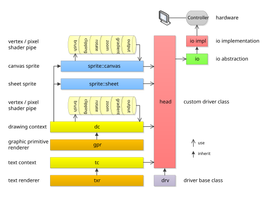
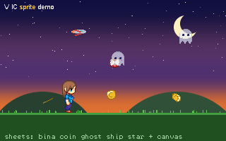
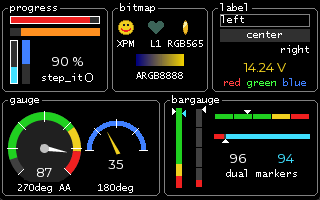
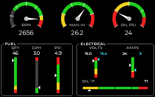
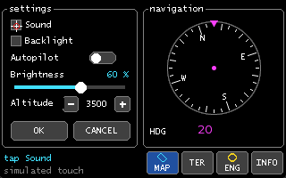
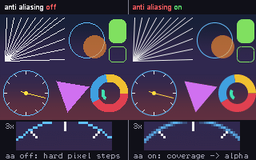

# Video Interface Controller library

[](https://github.com/mpaland/vic/tags)
[](https://github.com/mpaland/vic/actions/workflows/ci.yml)
[](https://en.cppreference.com/w/cpp/11)
[](#highlights-and-design-goals)
[](#highlights-and-design-goals)
[](.github/workflows/ci.yml)
[](https://github.com/mpaland/vic/commits/master)
[](https://github.com/mpaland/vic/issues)
[](https://github.com/mpaland/vic/stargazers)
[](LICENSE)


### A universal, lightweight, extremly fast and powerful C++ library for driving graphic, dot, alpha numeric and seven-segment displays in embedded systems

## Highlights and Design Goals
- Designed for displays on **(slow) serial buses** like SPI, I²C or UART: primitives are rendered with a minimum of
  commands sent to the display, no framebuffer transfer is needed (but supported)
- Blazing fast primitive rendering of lines, circles, triangles, boxes, text etc.
- Sprite Engine (sheet and dynamic canvas) for moving objects with rotation, zoom and collision detection
- Vertex/pixel shader pipe with dynamic clipping, gradient, brush, zoom, rotate etc. shaders
- Support of all color formats from monochrome up to 32 bit alpha blending color displays
- Full transparency and alpha channel blending support out of the box
- Anti aliasing support for smooth edges of lines, circles, discs, sectors and triangles
- HEADER ONLY implementation, no module compilation
- Multi display support, as many displays as you may like in one system
- Multihead driver, combine any number of (different) single displays to one big display screen
- Platform and CPU independent code, NO dependencies, NO STL, NO new/delete, NO `float` - just clean and pure C++(11)
- Platform independent low level driver design with I/O abstraction, **the very same low level display driver runs everywhere**
- Simple widgets like bitmaps (raw and XPM), gauges, checkboxes, progress bars, etc.
- Support of different font formats (proportional, monospace), ASCII/UTF-8 support and text/font rendering
- Framebuffer, viewport and blitter support
- **NO floating point math**, only fast integer operations
- VERY clean, mature and stable C++ code, LINT and L4 warning free, automotive ready
- Very easy to use and fast implemention of own/new display drivers
- Extensive unit test suite, built and run with MSVC, GCC, Clang and sanitizers on every commit
- Doxygen commented code
- MIT license

## What is VIC _not_?
VIC is not meant to be a fully loaded window manager, widgets, dialogs and theme rendering framework.
If you need an advanced windowed GUI, there are many other cool libraries around, like LVGL, µC/GUI, StWin etc.
But such a (high level) library may use VIC as its rendering and display driver layer via the `blit()` command.
  
**VIC or a GUI framework like LVGL?** VIC is a graphic/widget rendering and display driver layer, not a GUI. If your display is a
TFT, your controller has RAM for a framebuffer and you need advanced controls, themes, a GUI framework is the right tool. VIC is made
for the other cases: Write only or serial displays, controllers with their own GRAM and native fill commands,
monochrome and odd devices (OLEDs, LED matrices, VFD text displays, seven segment), heterogeneous multihead setups and
MCUs with a few KB of RAM. Both can be combined: a GUI framework's flush callback is exactly a `blit()`, so a VIC head
can serve as its display driver.

## Design of VIC
Most display libraries render into a RAM framebuffer and transfer the complete buffer to the display afterwards.
This works fine for memory mapped displays, but embedded displays are often connected via SPI, I²C or UART with a
few MBit/s or even kBit/s. Transferring a complete framebuffer over such a link takes far too long for fast updates,
and small microcontrollers don't have the RAM for a big framebuffer anyway.

VIC therefore renders **directly to the display** and tries to send as few commands as possible:
- Every primitive is decomposed into the most powerful commands the display controller understands. If the controller
  can fill a box or draw a horizontal line natively, a disc is sent as a handful of line commands instead of thousands
  of pixels. A head driver simply overrides `line_horz`, `line_vert`, `box` or `move` to make use of such commands.
- Only what changes is drawn. Sprites restore just their background, the progress bar widget draws only the delta.
- Alpha blending and anti aliasing read the background pixel back from the display (or use a framebuffer head /
  a canvas sprite when the display is write only), everything else is write only traffic.
- If a display or an application really needs a framebuffer, the `framebuffer` and `memory` heads provide one in RAM
  and the display is updated with `present()`.

**Displays which can't read their pixels back** (most serial displays) return `color::none` from `pixel_get()`. The
drawing context then blends alpha and anti aliasing pixels against its background color once one is set with
`dc::set_bg_color()`, which is exact on uniform backgrounds and needs no RAM. If the real pixels are needed (sprites, fill, anti aliasing on
images), put the `framebuffer` head between the display driver and the drawing context. It keeps a RAM copy in the
format you choose (ARGB8888, RGB565, RGB332 or 1 bit L1), remembers the dirty rect and transfers only the changed
window with `blit()` on `present()`. This is also the "render in RAM, stream the changed window" model modern TFT
controllers with an autoincrementing GRAM window are made for, and it is the user's decision per display, the device
drivers themselves keep no buffers.


## Class design



The hardware graphic display driver is called _head_ here and only needs to implement `pixel_set` and `pixel_get` functions. But most modern display controllers can provide more sophisticated functions for native line/box rendering, block moving (blit) etc.
If a controller can provide such special functions, the according function is implemented in the driver by simply overriding the virtual function of the `drv` base class.
All graphic functions which the controller/driver can't provide natively are handled by the `gpr`.
Of cource, native rendering on a specialized LCD controller is always faster and should be prefered.

The native hooks are deliberately limited to primitives which have exactly one correct pixel result: `line_horz`,
`line_vert`, `box`, `move`, `cls` and `blit` (a block of pixels). Everything else (diagonal lines, circles, discs,
sectors, triangles, text) is decomposed by the `gpr` into these hooks, so every head renders exactly the same pixels
and the anti aliasing stays deterministic: the interior of an anti aliased disc is still sent as native horizontal
runs, only the edge pixels are single alpha pixels. There are no hooks for native diagonal lines or circles on
purpose, a controller's own algorithm would make the result head dependent.

### gpr
The Graphic Primitive Renderer provides fast rendering functions for all basic primitives like lines, circles, triangles, discs, pies, pattern fill, etc.
The `gpr` doesn't use any floating point math, only fast integer operations.
Furthermore the `gpr` should be a collection of the fastest implementations of the most modern, fast and reliable primitive rendering algorithms.
So, if you find any errors, have speed improvements or even a better algorithm for some primitives - **please** share and contribure!

All rects (`rect_type`) are right/bottom **exclusive**, like `{ left, top, right, bottom }` covers the pixels
`left <= x < right` and `top <= y < bottom`. Angles are given in degrees, 0° is at 12 o'clock and angles run
clockwise. Angle intervals like in `sector()` are half open (`[start, end)`), so adjacent sectors tile without gaps
or double drawn pixels.

### txr
The Text Renderer is responsible for rendering text fonts on graphic displays. It supports antialiasing, monospaced and proportional fonts.

Fonts are header files in `src/font/`, a font is a class with one `info()` method which returns the glyph data
(`font::font_type`, see `src/font.h`). Available fonts:
- `LCD_6x8`, `LCD_6x10`, `LCD_8x8`: monospaced 1 bit pixel fonts for small displays
- `Montserrat_10_aa2`, `Montserrat_12_aa2`, `Montserrat_16_aa4`, `Montserrat_24_aa4`: proportional, anti aliased,
  ASCII + Latin-1, generated from the Montserrat TTF (OFL)
- `Microgramma_10_aa2`, `Microgramma_12_aa2`, `Microgramma_16_aa4`, `Microgramma_24_aa4`: same for the Microgramma TTF,
  ASCII only (the TTF has no lowercase and carries Cyrillic letters in its Latin-1 slots)
- `Arial_std_12_aa2`, `Arial_num_16x24_AA4`: legacy fonts

New fonts are generated from any TTF/OTF file with `tools/fontgen.py` (Python 3 with `freetype-py`, Pillow for
the optional preview), the number is the line
height in pixel and `--bpp` the gray levels (1 = mono, 2 or 4 = anti aliased):
```
python tools/fontgen.py src/font/ttf/Montserrat-Regular.ttf --size 12 --bpp 2
python tools/fontgen.py myfont.ttf --size 20 --bpp 4 --ranges 20-7E --name MyFont_20 --preview myfont.png
```
The glyphs are hinted with the FreeType auto hinter and stems thinner than a pixel are darkened, so a stem is one
solid pixel column instead of two gray ones (`--darken`, automatic by default).
`tools/gen_fonts.cmd` regenerates all fonts above. Rule of thumb for the flash size: about
`glyphs * (height * width * bpp / 8 + 8)` byte, e.g. 190 glyphs of a 12 px 2 bit font take about 5 KB, a 24 px
4 bit font about 30 KB. Restrict the ranges (`--ranges 30-39` for digits) if a display only shows numbers.

### dc
To draw anything on the screen, at least one Drawing Context is necessary.
The `dc` stores information about the pen color, the anti aliasing setting and has an associated pipe of shaders.
Shaders are extremly fast and modify the rendered pixel (or its position) before it is sent to the head driver.
Several drawing contexts can share one head.

Available stock shaders are:
- alpha blender
- clipping
- zoom
- offset
- flip
- tint
- brush
- gradient (linear, radial, sweep)
- rotate

### tc
The Text Context is the counterpart of the `dc` for text only (Alpha Numeric) displays. It renders UTF-8 strings with the selected font, including control chars like `\n`, `\r` and the inline color escape `\aRRGGBB`.

### drv
The base class of the custom head driver which adds some mandatory driver routines.
All vic color calculations are done in ARGB 32 bit format. If a display has less colors, like 15 bit RGB, the specific driver
class is responsible for color reduction. Conversion routines provides the `color` class.

### head
The specific display driver. A display together with its controller is referenced here as `head`. And `head` is the namespace of all specific drivers.
Available heads: `MIPI_DCS` (ILI9341, ILI9488, ST7735, ST7789, ST7796, GC9A01 TFTs), `ILI9325`, `SSD1331` and `SSD1351` (RGB OLED),
`SSD1306` (SSD1306, SSD1309, SH1106), `SSD1322` (gray scale OLED), `PCD8544`, `ST7565` (ST7565, ST7567, UC1701), `ST7920` (mono LCD),
`SSD1680` (SSD1680 / SSD1681 e-paper), `HD44780` and `BA6x` (alphanumeric), `Digole`, `MAX7219`, `STPxxP05`, `seven_segment`, the virtual heads
`framebuffer` (RAM framebuffer with dirty rect transfer in front of any other head), `memory` (pure RAM head with statistics, ideal for unit
tests and off screen rendering), `multihead`, `dummy` and the `windows` head which emulates a display in a window
for development. `skeleton.h` is the template for new heads. `src/head/doc/` holds the controller datasheets and a
programming summary (`*.md`) of each one with the register / command tables, the orientation bits and what the head sends.

### sprite
I have always been fascinated by hardware sprites that computers like the Commodore 64 or Amiga offered. When designing VIC, I wanted to create a simple but fast and flexible sprite rendering engine with collision detection, rotation and unlimited sprite layers.  
Sprites are moving objects which restore their background when they move. `sprite::sheet` renders frames out of a
constant sprite sheet (RGB565, RGB888, ARGB8888, RGBA8888) and needs no RAM for the pattern, `sprite::canvas` is a
sprite which can be drawn on with the normal `dc` functions and `sprite::canvas_sheet` loads sheet frames into a
canvas. Canvas sprites can be rotated by any angle at zero cost when no rotation is used. Overlapping sprites are
rendered in z-order with alpha blending. Pixel exact collision detection comes for free: set a collision handler
(`set_collision_handler()`) on a sprite and it is called once for every other sprite it overlaps with when it is
rendered, or poll `get_collision()` after `render()`. Without a handler the detection costs nothing.

The `demo/demo_sprite.cpp` is completely rendered by VIC primitives and shows sheet sprites, a canvas sprite (the ball), rotation,
alpha blending, z-order and the collision detection (the ghosts turn red when they meet):



### widget
Simple widgets which are useful in nearly every embedded project: `widget::bitmap` renders raw bitmaps (L1, RGB332,
RGB555, RGB565, RGB888, ARGB8888) and XPM3 images, `widget::progress` is a progress bar with four orientations and
delta drawing. For instrument style displays there are `widget::gauge` (round arc gauge with colored bands, ticks
and a needle), `widget::bargauge` (linear band strip with up to two triangle markers and an optional fill bar),
`widget::label` (text or fixed point numeric readout in a cell, redrawn only when the text changes),
`widget::textbox` (multi line text with word wrap and line scrolling), `widget::groupbox` (titled frame),
`widget::led` (round or square indicator), `widget::arc` (ring progress, delta drawn) and `widget::spinner`
(rotating ring segment as busy indicator). The needle and the markers are canvas sprites, so a value change
costs only their pixels and the background restores itself. 
`widget::compass` is a heading up compass rose with a fixed pointer. 
  
Input routing is one function: the application calls `widget::base::event({x, y}, widget::event_tap)` from
its touch, mouse or button driver with the position and the event (`event_down`, `event_up`, `event_tap`,
`event_long_tap`). The widget under the position reacts first (the one created last wins when widgets
overlap) and then calls the handler set with `set_event_handler()`. The input widgets build on it:
`widget::button` and `widget::imagebutton` (icon and caption, soft keys with an active state) show a pressed
look between down and up, `widget::checkbox` and `widget::toggle` (a switch) toggle on a tap, `widget::slider`
takes its value from the tap position and `widget::spinbox` steps its value with its minus and plus cells
(a long tap is ten steps). `demo/demo_input.cpp` is a settings page operated by a simulated touch. There is no
focus, no styles and no theme engine, full featured GUIs belong to a library on top of VIC.

`demo/demo_widget.cpp` shows every widget with its specific features (orientations, border, bitmap formats,
alignment, color escapes, bands, ticks, fill mode, dual markers, anti aliasing, the input widgets operated by
a simulated touch) on three pages, 30 s recording:



`demo/demo_gauges.cpp` shows the gauge widgets on an aircraft engine page:



`demo/demo_input.cpp` is a settings page with checkboxes, a switch, a slider, a spinbox, buttons, a compass and
a soft key bar, operated by a simulated touch through `widget::base::event()`:




## Anti aliasing
Anti aliasing is switched on per drawing context with `dc.anti_aliasing_enable(true)` (and off again with `false`).
It is off by default and the normal rendering is not affected by it at all.

The principle is *pixel coverage*: every pixel which is only partly covered by the primitive gets the pen color with
an alpha channel of `pen alpha * coverage / 255`. This alpha pixel takes the normal alpha path of vic, so the output
shader blends it with the pixel the head reads back, and a canvas sprite blends it into its pattern. No floating point
math is used anywhere.

- **Lines** (and therefore polylines and triangle outlines) use the Xiaolin Wu algorithm: for every step along the major
  axis the two nearest pixels are drawn, their coverages always sum up to 255. The end points are drawn exactly, axis
  aligned lines are drawn as plain lines.
- **Circles, discs, disc sectors, sectors and solid triangles** test their edge pixels against the exact shape with a
  4 x 4 sub pixel grid, so an edge pixel has 17 coverage levels. The exact shapes are: a disc is a circle with radius
  `r + 0.5`, a circle outline is the one pixel wide ring from `r - 0.5` to `r + 0.5`, a sector is the ring from
  `inner - 0.5` to `outer + 0.5` (its outer edge is the edge of a disc with the outer radius, so an anti aliased pie
  equals a disc and a ring sits exactly on a disc with radius `inner - 1`), it keeps its half open angle interval
  `[start, end)`, and a triangle covers everything on or inside its edges. The result has the same visual size as the
  non anti aliased primitive. Fully covered pixels are drawn as solid horizontal runs, so the interior is
  still rendered with the native line functions of the head and only the edge pixels are single alpha pixels.
- Rounded boxes and rectangles get anti aliased corners, their straight parts stay as they are.
- Not affected: pixels, axis aligned lines, boxes, plain rectangles and text. Fonts bring their own anti aliasing with
  2, 4 or 8 bit per pixel glyphs, the text renderer maps the pixel intensity to the alpha channel in the same way.

Costs: the edge pixels cost CPU time (16 shape tests per edge pixel, 9 per interior pixel inside the bounding box) and
every edge pixel needs the background pixel for the alpha blending. On a write only serial display (no `pixel_get`
support) the output shader can't blend, so use anti aliasing there with the `framebuffer` head, with a head that keeps
its own framebuffer (like the SSD1306 head) or on canvas sprites which keep their own pixels anyway. Coordinates have to
stay within +/- 4000 pixels for the 32 bit sub pixel math.

```c++
vic::dc _dc(_head);
_dc.anti_aliasing_enable();                   // from now on edges are smooth
_dc.set_color(vic::color::white);
_dc.line({ 10, 10 }, { 100, 40 });            // Wu line
_dc.disc({ 60, 60 }, 25U);                    // disc with coverage sampled edge
_dc.sector({ 60, 60 }, 10U, 25U, 30U, 150U);  // ring piece, radial and angular edges are smooth
_dc.anti_aliasing_enable(false);              // back to plain pixels
```

`demo/demo_aa.cpp` renders the same scene twice, left without and right with anti aliasing, with a 3x magnifier
of the moving clock hand (30 s recording of the demo):




## Usage
Using VIC is really easy and fun. Add the `src` folder to your include path (or link the `vic::vic` CMake interface
target) and provide the I/O functions declared in `io.h` for your platform (SPI/I²C/UART/memory access, delay).
In a single head design (just one display in the system) you create your head first by instancing the according driver.
E.g. on a Windows (emulation/test) platform this would be:
```c++
#include "head/Windows.h"

// Create a screen of 240 * 120 pixel with a viewport of the same size (240 * 120)
// The viewport has an offset of 0,0 and the window is placed at 100,100 on the windows desktop
// For development convinience a horizontal and vertical zoom factor of 4 is selected
vic::head::windows<240, 120, 240, 120> _head(0U, 0U, 100U, 100U, 4U, 4U);
_head.init();  // explicit head init
```

Drawing is done with a drawing context (`dc`) and text is written with a text context (`tc`) on the head:
```c++
#include "dc.h"
#include "tc.h"
#include "font/Arial_num_16x24_AA4.h"

vic::dc _dc(_head);
_dc.set_color(vic::color::brightblue);    // select bright blue drawing color
_dc.line({ 10, 10 }, { 40, 40 });         // draw a line from 10,10 to 40,40
_dc.box({ 50, 10, 90, 30 }, 4U);          // filled box with rounded corners, right/bottom exclusive
_dc.disc({ 120, 60 }, 20U);               // filled circle

// write some text
vic::tc _tc(_head);
vic::font::Arial_num_16x24_AA4 _font;
_tc.set_font(_font);
_tc.set_color(vic::color::yellow);
_tc.out({ 10, 50 }, (const std::uint8_t*)"12,34.56-7890");
```

If you need multiple displays in your design, we are talking about a "multiple heads" scenario. All heads are independent.
Let's create two independent heads with their own drawing contexts:
```c++
vic::head::windows<240, 120, 240, 120> _head0(0U, 0U, 0U,   0U, 2U, 2U);
vic::head::windows<240, 120, 240, 120> _head1(0U, 0U, 0U, 200U, 2U, 2U);
_head0.init();  // explicit head 0 init
_head1.init();  // explicit head 1 init

vic::dc _dc0(_head0);
vic::dc _dc1(_head1);
_dc0.set_color(vic::color::brightblue);
_dc0.line({ 10, 10 }, { 40, 40 });
_dc1.set_color(vic::color::red);           // eg. for system debug, status etc.
_dc1.box({ 100, 100, 120, 120 });
```

Or you can combine multiple single displays to one big screen. It's a common way to create big screens out of single modules.
This is done by using the `multihead` driver.
```c++
#include "head/MAX7219.h"
#include "head/multihead.h"

// Create 3 MAX7219 heads of 8 * 8 pixels on the SPI device handles spi1, spi2 and spi3
vic::head::MAX7219<8U, 8U> _head0(spi1);
vic::head::MAX7219<8U, 8U> _head1(spi2);
vic::head::MAX7219<8U, 8U> _head2(spi3);
// Create the multihead out of the three heads with offsets of 0, 8 and 16 pixels
// So the multihead has a screen resolution of 24 * 8 pixels
vic::head::multihead<24U, 8U, 3U> _multihead = { { _head0, { 0, 0 } }, { _head1, { 8, 0 } }, { _head2, { 16, 0 } } };

// Now, use the multihead like a normal head
vic::dc _dc(_multihead);
_dc.line({ 0, 0 }, { 23, 7 });
```

Shaders are registered at a drawing context and transform every pixel on its way to the head:
```c++
#include "shader/base.h"
#include "shader/gradient.h"

vic::shader::clipping _clip({ 0, 0, 100, 50 });          // draw only inside this rect
vic::shader::gradient<2U> _gradient = { { { 10, 25 }, vic::color::red },   // color points, the pixel color is
                                        { { 90, 25 }, vic::color::blue } }; // interpolated by distance
_dc.shader_register(&_clip);
_dc.shader_register(&_gradient);
_dc.disc({ 50, 25 }, 40U);                               // clipped and gradient filled
_dc.shader_remove(&_gradient);
```


## Command reference
A compact overview of the public API. All coordinates are `vertex_type { x, y }` (int16), rects are
`rect_type { left, top, right, bottom }` with exclusive right/bottom, colors are `color::value_type` (ARGB8888).
Angles of `circle()` / `sector()` are degree, 0° at 3 o'clock, counter clockwise, half open `[start, end)`.

### Drawing context `vic::dc` (`dc.h`, derived from `gpr`)
```cpp
dc(drv& head);                                            // drawing context on a head (or a sprite canvas)

// state
void set_color(color::value_type color);                  // pen color
color::value_type get_color() const;
void set_bg_color(color::value_type bg);                  // blend background for write-only heads
void anti_aliasing_enable(bool enable = true);
void alpha_blending_enable(bool enable = true);

// pixels and lines
void pixel_set(vertex_type v);                            // without present()
void pixel_set(vertex_type v, color::value_type c);
color::value_type pixel_get(vertex_type v);
void plot(vertex_type v);                                 // pixel_set() + present()
void line(vertex_type v0, vertex_type v1);                // both end points included, Wu with AA
void line_horz(vertex_type v0, vertex_type v1);
void line_vert(vertex_type v0, vertex_type v1);
void polyline(const vertex_type* vertices, std::size_t count);

// shapes
void box(const rect_type& rect);                          // filled rectangle
void box(const rect_type& rect, std::uint16_t border_radius);
void box(vertex_type v0, vertex_type v1);
void rectangle(const rect_type& rect);                    // outline
void rectangle(const rect_type& rect, std::uint16_t border_radius);
void triangle(vertex_type v0, vertex_type v1, vertex_type v2);
void triangle_solid(vertex_type v0, vertex_type v1, vertex_type v2);
void circle(vertex_type center, std::uint16_t radius, std::uint16_t start_angle = 0, std::uint16_t end_angle = 360);
void disc(vertex_type center, std::uint16_t radius);
void disc_sector(vertex_type center, std::uint16_t radius, std::uint8_t quadrant);   // 0 TR, 1 TL, 2 BL, 3 BR
void sector(vertex_type center, std::uint16_t inner_radius, std::uint16_t outer_radius,
            std::uint16_t start_angle, std::uint16_t end_angle);                     // pie or ring segment
void fill(vertex_type start, color::value_type color, bool use_color_as_bounding = true);   // flood fill

// screen
void cls(color::value_type bg_color = color::none);
void move(const rect_type& source, vertex_type destination);
void blit(const rect_type& rect, const color::value_type* pixels, std::size_t stride);
void present();                                           // transfer to the display
void present_lock(bool lock = true);                      // nested, the last unlock calls present()
std::uint16_t screen_width() const;
std::uint16_t screen_height() const;

// shader pipe
void shader_register(shader::base* shader);               // inserted at the front of the pipe
bool shader_remove(const shader::base* shader);
void shader_init();                                       // remove all shaders
bool shader_is_active() const;
```

### Text context `vic::tc` (`tc.h`, derived from `txr`)
```cpp
tc(dc& _dc);                                              // text on a graphic head through a dc
tc(drv& head);                                            // text on an alpha numeric head
void set_font(const font::font_type& font);
void set_color(color::value_type color);
void set_pos(vertex_type pos);                            // pixel (graphic) or character cell (alpha)
void set_inverse(bool inverse = true);
std::uint16_t out(const std::uint8_t* utf8);              // \n, \r and \aRRGGBB color escapes, returns the chars
std::uint16_t out(vertex_type pos, const std::uint8_t* utf8);
void out(std::uint16_t ch);                               // one character
std::uint16_t get_extend(rect_type& rect, const std::uint8_t* utf8) const;   // size of a line without rendering
std::uint8_t char_width() const;
std::uint8_t char_height() const;
void cls(color::value_type bg_color = color::none);
void clear_eol(); void clear_sol(); void clear_line();    // alpha numeric heads
void present(); void present_lock(bool lock = true);
```

### Driver base `vic::drv` (`drv.h`, every head)
```cpp
void init();  void shutdown();
const char* version() const;
bool is_graphic() const;
std::uint16_t screen_width() const;  std::uint16_t screen_height() const;
std::uint16_t viewport_width() const;  std::uint16_t viewport_height() const;
void viewport_set(vertex_type v);  vertex_type viewport_get() const;
bool screen_is_inside(vertex_type v) const;  bool viewport_is_inside(vertex_type v) const;
void display_enable(bool enable = true);
void display_brightness(std::uint8_t level);
void display_contrast(std::uint8_t level);
std::size_t framebuffer_get_count() const;
bool framebuffer_set_access(std::size_t plane);
bool framebuffer_set_display(std::size_t plane, std::uint8_t alpha = 0);
```

### Heads (`head/*.h`)
| Head | Display |
|---|---|
| `BA6x` | Wincor Nixdorf BA60 / BA63 / BA66 customer displays |
| `Digole` | Digole serial graphic modules |
| `HD44780` | HD44780 / ST7066 / KS0066 character LCDs, 4 or 8 bit bus |
| `ILI9325` | ILI9325 TFT controller |
| `MAX7219` | MAX7219 / MAX7221 8 x 8 LED matrices |
| `MIPI_DCS` | MIPI DCS TFT controllers (ILI9341, ILI9488, ST7735, ST7789, ST7796, GC9A01 ...) |
| `PCD8544` | Nokia 5110 / 3310 LCD |
| `SSD1306` | SSD1306 / SSD1309 / SH1106 monochrome OLEDs |
| `SSD1322` | SSD1322 4 bit grayscale OLEDs |
| `SSD1331`, `SSD1351` | 96 x 64 and 128 x 128 RGB565 OLEDs |
| `SSD1680` | SSD1680 / SSD1681 e-paper |
| `ST7565` | ST7565 / ST7567 / UC1701 monochrome COG LCDs |
| `ST7920` | ST7920 monochrome graphic LCD |
| `STPxxP05` | STP08xP05 / STP16xP05 / STP24DP05 LED array drivers |
| `seven_segment` | seven segment displays |
| `framebuffer` | RAM framebuffer between a display head and the drawing context, dirty rect transfer |
| `multihead` | combines several heads to one screen |
| `memory`, `dummy`, `windows`, `skeleton` | test head, null head, Windows window, template for new heads |

### Sprites `vic::sprite` (`sprite.h`)
```cpp
canvas<Pixel, Frames>(drv& head, std::int16_t z_index = 0);   // dynamic sprite, drawn with the dc functions
sheet<Width, Height>(drv& head, const sheet_info_type* sheet, std::int16_t z_index = 0);   // frames from a sprite sheet
canvas_sheet<Pixel>(drv& head, const sheet_info_type* sheet, std::int16_t z_index = 0);   // sheet frames, rotatable

void render(vertex_type position, std::uint16_t frame = 0);   // move / show, an invalid frame (0xFFFF) hides
vertex_type get_position() const;
std::int16_t get_z_index() const;
void set_rotation(std::int16_t angle, vertex_type center = { 0, 0 });   // canvas, degree, clockwise
void select_frame(std::uint16_t frame);                   // canvas: edit frame
void cls();                                               // canvas: clear the edit frame
std::uint16_t frame_count() const;  std::uint16_t pixel_count() const;
void set_collision_handler(collision_handler_type handler, void* arg = nullptr);
base* get_collision() const;
```

### Shaders `vic::shader` (`shader/*.h`)
| Shader | Function |
|---|---|
| `clipping(rect, inside = true)` | clip to or out of a rect |
| `zoom(x_level, y_level)` | integer zoom |
| `offset(vertex)` | move everything by an offset |
| `flip()` | mirror horizontally / vertically around an axis |
| `rotate(center, angle)` | rotation in degree |
| `tint(color, weight)` | tint every pixel |
| `alpha_blend()` | blend with the background |
| `brush()` | pen shapes (solid, dash, dot, dashdot) of 1 to 4 pixel |
| `gradient<N>`, `gradient_horizontal<N>`, `gradient_vertical<N>`, `gradient_solid<N>` | color gradients from N points |

### Widgets `vic::widget` (`widget/*.h`)
Every widget takes the head and a `config_type` struct, `init()` draws it.
| Widget | Main functions |
|---|---|
| `progress` | `set_pos()`, `set_range()`, `set_step()`, `step_it()`, `set_color()` |
| `bitmap` | `render_raw(origin, w, h, format, data)`, `render_xpm(origin, xpm)` |
| `label` | `set_text()`, `set_value(value, decimals, suffix)`, `set_color()` |
| `textbox` | `set_text()`, `scroll()`, `set_first_line()`, `get_line_count()` |
| `groupbox` | `set_title()` |
| `led` | `set_state()`, `toggle()`, `set_color()` |
| `gauge<>` | `set_value()`, `set_range()`, `anti_aliasing_enable()` |
| `bargauge<>` | `set_value(marker, value)`, `set_range()` |
| `arc` | `set_value()`, `set_range()`, `set_color()`, `anti_aliasing_enable()` |
| `spinner` | `step()`, `set_pos()`, `anti_aliasing_enable()` |
| `compass` | `set_heading()`, `anti_aliasing_enable()` |
| `button`, `imagebutton` | pressed look on down / up, `set_caption()`, `set_active()` (imagebutton) |
| `checkbox` | `set_checked()`, `toggle()`, toggles on tap |
| `toggle` (switch) | `set_state()`, `toggle_state()`, toggles on tap |
| `slider` | `set_value()`, `set_range()`, value follows the tap / down position |
| `spinbox` | `set_value()`, `set_range()`, `set_step()`, tap / long tap on the minus and plus cells |

Input routing:
```cpp
widget::base::event(vertex_type pos, widget::event_type ev);   // event_down, event_up, event_tap, event_long_tap
void set_event_handler(event_handler_type handler, void* arg = nullptr);   // per widget callback
void event_enable(bool enable = true);                    // exclude a widget from the routing
widget::base* find(vertex_type pos);                      // hit test
```

### Colors and helpers (`color.h`, `util.h`)
```cpp
color::argb(r, g, b, a = 255);  color::hsv(hue, saturation, value, alpha = 255);
color::get_red() / get_green() / get_blue() / get_alpha();  color::set_alpha(color, alpha);
color::mix(fg, bg, lum);  color::dim(color, lum);  color::alpha_blend(front, back);
color::black, white, gray, gray01 .. gray15, red, green, blue, yellow, cyan, magenta, orange, ..., none
util::sin(degree);  util::cos(degree);                    // * 16384, integer
util::vertex_rotate(point, center, degree);               // clockwise on screen
util::isqrt(value);  util::distance_squared(v0, v1);  util::abs(value);  util::min2() / max2()
```

## Building and testing
VIC itself is header only and needs no build. The repository contains a CMake project which builds the unit tests
(`test/`) and, on Windows, the demos (`demo/`): a clock, a sprite demo (`demo_sprite.cpp` with sprite sheets,
rotation and anti aliasing), the anti aliasing comparison (`demo_aa.cpp`), a font demo (`demo_font.cpp`, cycles
through all fonts with a pangram, digits and Latin-1 samples), the widget demo (`demo_widget.cpp`, every widget
with its features), the gauge demo (`demo_gauges.cpp`, an aircraft engine page) and the input demo
(`demo_input.cpp`, a settings page operated by a simulated touch).

`demo/heads/` holds one small portable program per head (`vic_head_<name>`): it instantiates the head for a common
module with the orientation the module needs, draws a test scene and runs with the tracing io layer
`demo/heads/io_trace.cpp`, which has no hardware behind it and dumps the command / data stream to stdout. Copy a
head demo and replace the four `vic::io` functions with your bus code to bring up a display.

```
cmake -S . -B build -G Ninja -DCMAKE_BUILD_TYPE=Release
cmake --build build
ctest --test-dir build --output-on-failure
```
On Windows just run `build.cmd [Debug|Release]` from a normal shell, it locates Visual Studio and does the above.
The tests are compiled with `/W4 /WX /permissive-` (MSVC) resp. `-Wall -Wextra -Wpedantic -Wshadow -Werror` in strict
C++11 mode (GCC, Clang); `-DVIC_TEST_ASAN=ON` builds them with address and undefined behaviour sanitizers.
The test framework (`test/vic_test.h`) is self contained, the tests render on the `memory` head and compare the result
with ASCII art rasters, so new primitives and heads are easy to test.


## Projects Using VIC
- [turnkeyboard](https://github.com/mpaland/turnkeyboard) uses VIC as universal display library.
(Just send me a mail/issue to get your project listed here)


## Contributing
1. Give this project a :star:
2. Create an issue and describe your idea
3. [Fork it](https://github.com/mpaland/vic/fork)
4. Create your feature branch (`git checkout -b my-new-feature`)
5. Commit your changes (`git commit -am 'Add some feature'`)
6. Publish the branch (`git push origin my-new-feature`)
7. Create a new pull request
8. Profit! :heavy_check_mark:


## License
VIC is written under the MIT licence.
